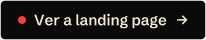
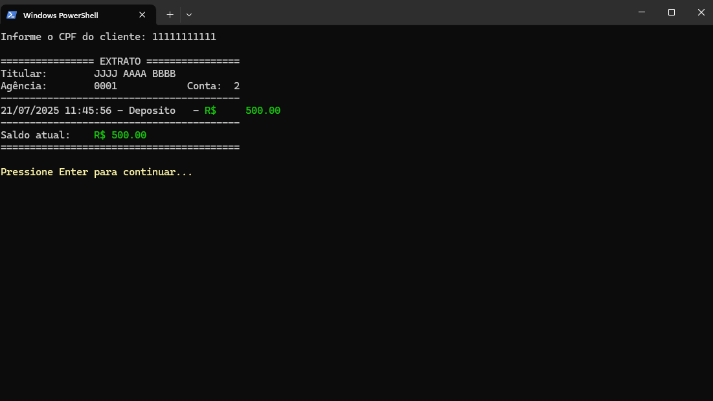

<a id="top"></a>

<div align="center">


<h1>Simple Bank</h1>

<p>
  <strong>Simulador de banco no terminal, em Python, com contas, depósitos e saques.</strong><br />
  <sub>Foco em código limpo, POO, exceções e validação de entrada</sub>
</p>

<p>
  <a href="https://voaneves.github.io/simple-bank/"><picture><source media="(prefers-color-scheme: dark)" srcset="https://raw.githubusercontent.com/voaneves/simple-bank/main/assets/buttons/landing-dark.svg" /></picture></a>
  <a href="https://github.com/voaneves/simple-bank/blob/main/simple_bank.py"><picture><source media="(prefers-color-scheme: dark)" srcset="https://raw.githubusercontent.com/voaneves/simple-bank/main/assets/buttons/code-dark.svg" /></picture></a>
</p>

<p><sub>Precisa de algo assim? <a href="https://voaneves.com/#contato"><strong>Vamos conversar →</strong></a></sub></p>

<p>
  <a href="https://github.com/voaneves/simple-bank/blob/main/LICENSE"></a>
  
  <a href="https://github.com/voaneves/simple-bank/issues"></a>
</p>

<p>
  <a href="#sobre-o-projeto">Sobre</a> ·
  <a href="#arquitetura-e-design-de-código">Arquitetura</a> ·
  <a href="#como-começar">Como começar</a> ·
  <a href="#contribuindo">Contribuindo</a> ·
  <a href="#contato">Contato</a>
</p>

</div>

<picture>
  <source media="(prefers-color-scheme: dark)" srcset="https://raw.githubusercontent.com/voaneves/simple-bank/main/assets/brand/rule-dark.svg" />
  <source media="(prefers-color-scheme: light)" srcset="https://raw.githubusercontent.com/voaneves/simple-bank/main/assets/brand/rule-light.svg" />
  
</picture>

## Sobre o Projeto

Simple Bank simula, no terminal, as operações básicas de um banco: clientes, contas, depósitos e saques.

"Simple Bank" é uma aplicação de console desenvolvida em Python que simula as operações fundamentais de um sistema bancário. O projeto nasceu como um desafio técnico para aplicar e demonstrar, de forma clara e prática, os conceitos essenciais da engenharia de software e da programação orientada a objetos.

O objetivo não é ser um produto financeiro, mas sim um portfólio robusto que ilustra a habilidade de estruturar um código limpo, modular e de fácil manutenção. **A versão 2.0 evolui a arquitetura para incluir um sistema de tratamento de erros com exceções customizadas e validação de entrada, tornando o software significativamente mais confiável e profissional.**

<p align="center">
  
</p>

### Tecnologias Utilizadas

Este projeto foi construído inteiramente com recursos nativos do Python, demonstrando a força da linguagem sem a necessidade de frameworks externos.

* **Python 3.8+**
* Módulos Nativos:
    * `os` e `sys` para interação com o sistema.
    * `datetime` para timestamp das transações.
    * `abc` para criação de classes abstratas.
    * `textwrap` para formatação de texto. 

## Arquitetura e Design de Código

A espinha dorsal do "Simple Bank" é sua arquitetura orientada a objetos. A estrutura foi pensada para ser extensível, testável e robusta.

### Princípios da Programação Orientada a Objetos (OOP)

Os quatro pilares da OOP são a fundação deste projeto:

1.  **Abstração:** Classes como `Transacao` definem um "contrato" genérico.
2.  **Encapsulamento:** Os atributos das classes (`_saldo`) são protegidos e acessados via métodos.
3.  **Herança:** A classe `ContaCorrente` herda de `Conta`, especializando o comportamento.
4.  **Polimorfismo:** O método `registrar()` se comporta de maneira diferente para `Saque` e `Deposito`.

### Separação de Responsabilidades

O código é organizado em camadas lógicas para maior clareza:

-   **Modelo (Model):** As classes (`Cliente`, `Conta`, etc.) que representam as regras de negócio do banco.
-   **Visão (View):** Funções (`exibir_mensagem`, `limpar_tela`) responsáveis pela interação visual.
-   **Controle (Controller):** Funções (`executar_saque`, `criar_cliente`) que orquestram a interação entre a visão e o modelo.

### Tratamento de Erros e Robustez

A versão 2.0 foca em tornar o sistema mais confiável e profissional através de duas estratégias principais:

1.  **Exceções Customizadas:** Em vez de imprimir erros diretamente da lógica de negócio, o sistema agora lança exceções específicas (ex: `SaldoInsuficienteError`, `LimiteSaqueError`). Isso **desacopla totalmente o modelo da visão**, permitindo que a lógica do banco seja reutilizada em outras interfaces (como uma API web) sem alterações. A camada de controle é responsável por capturar essas exceções e apresentar mensagens amigáveis ao usuário.
2.  **Validação de Entrada:** Foi implementada uma função para validar dados de entrada, como o CPF, garantindo que apenas informações no formato correto sejam processadas. Isso previne erros e aumenta a integridade dos dados do sistema.

## Como Começar

Para executar o projeto localmente, siga estes passos.

### Pré-requisitos

A única dependência é ter o Python 3 instalado em sua máquina.

* **Python 3**
    ```sh
    python --version
    ```

### Execução

1.  Clone o repositório para sua máquina local.
    ```sh
    git clone https://github.com/voaneves/simple-bank.git
    ```
2.  Navegue até a pasta do projeto.
    ```sh
    cd simple-bank
    ```
3.  Execute o script principal.
    ```sh
    python simple_bank.py
    ```

## Contribuindo

Contribuições tornam a comunidade de código aberto um lugar incrível para aprender, inspirar e criar. Qualquer contribuição que você fizer será **muito bem-vinda**.

Se você tem uma sugestão para melhorar este projeto, por favor, faça um fork do repositório e crie um pull request. Você também pode simplesmente abrir uma issue com a tag "melhoria".

1.  Faça o Fork do Projeto
2.  Crie sua Feature Branch (`git checkout -b feature/FuncionalidadeIncrivel`)
3.  Faça o Commit de suas alterações (`git commit -m 'Adiciona alguma FuncionalidadeIncrivel'`)
4.  Faça o Push para a Branch (`git push origin feature/FuncionalidadeIncrivel`)
5.  Abra um Pull Request

## Agradecimentos

Este projeto é um reflexo do aprendizado contínuo e foi inspirado por diversos recursos e comunidades.

* A comunidade Python, por sua vasta documentação e bibliotecas.
* Tutoriais e cursos online que forneceram a base de conhecimento.
* A todos que dedicam seu tempo para criar documentação e templates de qualidade, como o [Best-README-Template](https://github.com/othneildrew/Best-README-Template) que serviu de inspiração para esta estrutura.

## Contato

<p>
  <a href="https://voaneves.com/#contato"><picture><source media="(prefers-color-scheme: dark)" srcset="https://raw.githubusercontent.com/voaneves/simple-bank/main/assets/buttons/hire-dark.svg" /></picture></a>
  <a href="https://voaneves.com/"><picture><source media="(prefers-color-scheme: dark)" srcset="https://raw.githubusercontent.com/voaneves/simple-bank/main/assets/buttons/site-dark.svg" /></picture></a>
</p>

<a href="https://linkedin.com/in/voaneves">LinkedIn</a> · <a href="mailto:victorneves478@gmail.com">E-mail</a>

<p align="center">
  
</p>

<p align="center"><sub>Distribuído sob a <a href="https://github.com/voaneves/simple-bank/blob/main/LICENSE">Licença MIT</a>.</sub></p>

<p align="center"><sub><a href="#top">↑ Voltar ao topo</a></sub></p>
